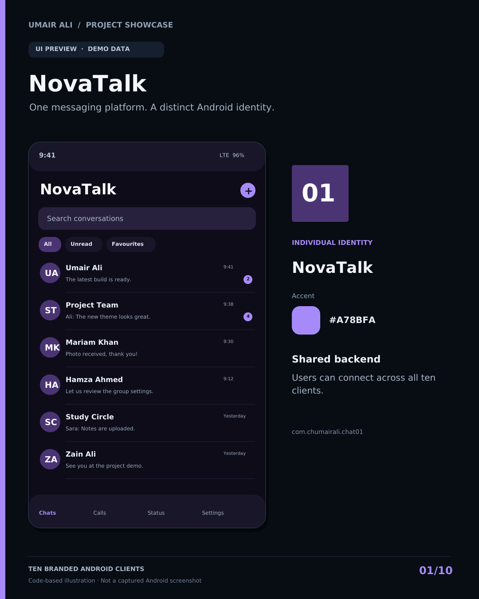

# Ten Branded Chat Apps

Ten themed Android clients derived from the same independent Flutter messaging project. Maintained by Umair Ali. Each has a unique Android application ID, display name, icon and palette, while all connect to the same configured backend. These are branded variants of one application, not ten independently engineered systems.



## Apps

| Source folder / APK | Display name | Android application ID |
|---|---|---|
| Chat_01 | NovaTalk | `com.chumairali.chat01` |
| Chat_02 | OceanTalk | `com.chumairali.chat02` |
| Chat_03 | ForestTalk | `com.chumairali.chat03` |
| Chat_04 | EmberTalk | `com.chumairali.chat04` |
| Chat_05 | RoseTalk | `com.chumairali.chat05` |
| Chat_06 | ArcticTalk | `com.chumairali.chat06` |
| Chat_07 | SolarTalk | `com.chumairali.chat07` |
| Chat_08 | IndigoTalk | `com.chumairali.chat08` |
| Chat_09 | MintTalk | `com.chumairali.chat09` |
| Chat_10 | SlateTalk | `com.chumairali.chat10` |

The configured backend is the owner's public deployment. For your own deployment, change the backend entries in apps.json before running BUILD_ALL.ps1; those values are passed as API_BASE_URL during compilation. Each client may also remember an explicitly selected runtime server. Do not enter private credentials on a server you do not control.

## Shared behavior

Users in different variants can find/chat with one another. Accounts, conversations and media are shared through the backend; local app sessions are isolated by Android application ID. Logging in to one account in several clients represents the same account, not several separate users. Backend authorization still governs what each account can see.

## Build all ten: Windows PowerShell

Requires a working Flutter SDK, JDK, Android SDK and accepted SDK licenses. Default Flutter executable: C:\src\flutter\bin\flutter.bat.

```powershell
Unblock-File -LiteralPath .\BUILD_ALL.ps1
Set-ExecutionPolicy -Scope Process -ExecutionPolicy RemoteSigned
.\BUILD_ALL.ps1
```

For a different SDK path: `.\BUILD_ALL.ps1 -Flutter 'C:\dev\flutter\bin\flutter.bat'`.

Build one: `.\BUILD_ALL.ps1 -From 1 -To 1`. Resume at app 4: `.\BUILD_ALL.ps1 -From 4`. Finished APKs are collected in APKs/Chat_01.apk through APKs/Chat_10.apk. The owner reported completion of all ten release builds on Windows; that report is not a claim that every flow was exhaustively tested in every app.

## Downloads

- [All ten source projects](downloads/Ten_Chat_Apps_Source.zip)
- [Ten brand UI previews](downloads/Ten_Brand_UI_Previews.zip)
- Check GitHub Releases for APKs uploaded from the owner's machine.

## Scope and limits

Android branding is configured. iOS folders retain original identifiers; ten independent iOS releases are not configured. Features and backend capacity are shared. Different branding does not increase server speed or capacity. The slow-app report has not been diagnosed/fixed by this branding work.

Original release build configuration signs using a development/debug key, so direct test installations work. Proper signing is required before a store release. Keep a private copy of your existing signing key for compatible updates; it is excluded from public source.

No E2E encryption, real WhatsApp account linking, guaranteed cross-network calls or background push. A working TURN relay may be needed for calls. The UI preview images are code-rendered illustrations with demo content; they are not captured Android screenshots. Every file has a visible label.

## Restore

Clone/download the source and run BUILD_ALL.ps1 on a configured Windows machine. Flutter dependencies and build outputs are regenerated. Shared_Backend/ includes a reference copy of the Flask/browser server. Existing deployed databases/uploads are private runtime data, not contained in this repository.

MIT for original code; see LICENSE. Not affiliated with WhatsApp or Meta.
